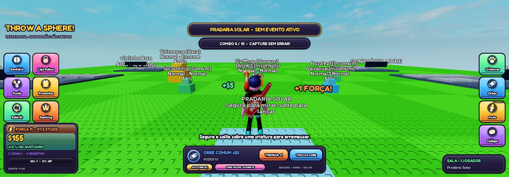
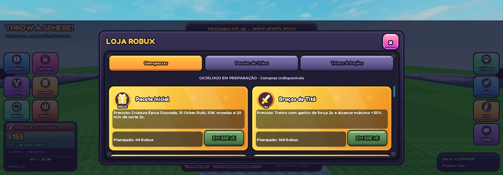
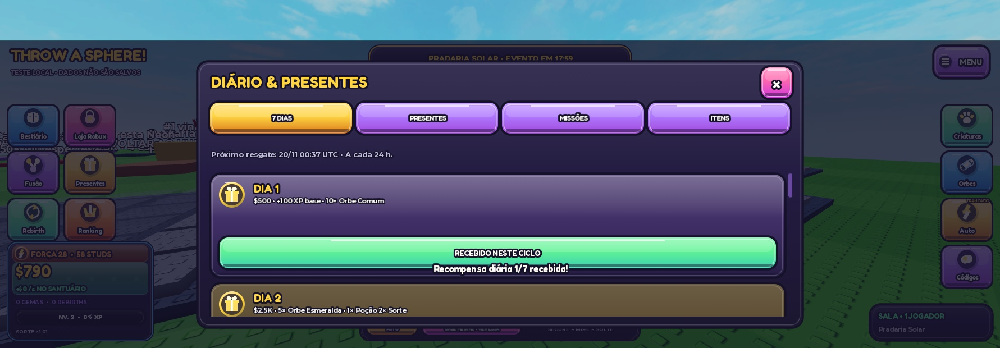
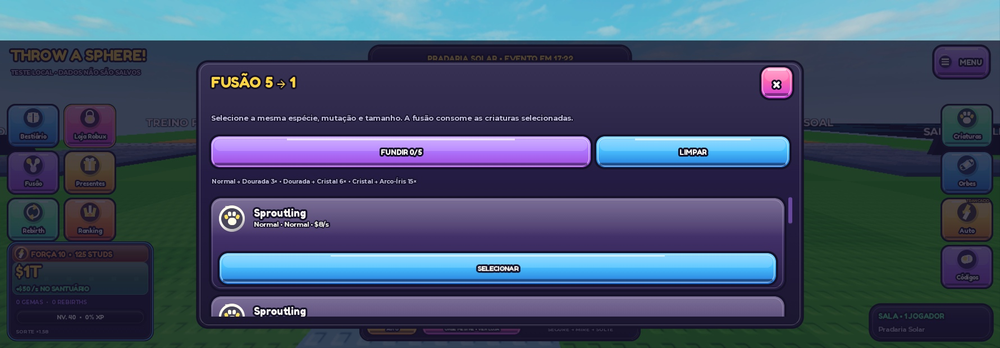

# Throw a Sphere! / Jogue uma Orbe!

Jogo Roblox de arremesso e captura de criaturas, com santuários que geram moedas, progressão, coleção e comércio. O repositório reúne o código Luau, o ambiente Rojo e toda a pesquisa original.

## Checkpoint para continuar em outro PC

**18/11/2026, 21:45 — Brasília (UTC−3), horário de consolidação previsto. Mecânicas do jogo base implementadas; validação local e preparação da entrega concluídas conforme os resultados abaixo.**

A base do passo 1 foi preservada e ampliada. O trabalho desta sessão inclui a UI refinada, os sistemas da Geração 1 e a migração dos saves para schema 2. Os modelos e as animações finais serão produzidos pelo usuário e integrados em uma próxima etapa; as 30 espécies usam modelos provisórios feitos de peças do Roblox.

| Etapa | Estado | Entrega |
| --- | --- | --- |
| Ambiente / GitHub | Ferramentas e projeto preparados | Rojo 7.7.0, Luau 0.747, instalação, build, testes e continuidade entre PCs |
| 1 — Núcleo jogável | Histórico validado no Studio | Mira, captura, santuários, renda, XP, inventário e persistência |
| 2 — Interface | Implementada e refinada | HUD, Big Numbers, efeitos, inventários e loja; primeiro HUD emulado em iPhone/Galaxy |
| 2B — Mecânicas base | Implementadas e testadas localmente | Progressão, recompensas, mundo, eventos, benefícios, comércio e menus conectados |
| QA dos novos menus | 13 painéis conferidos no Studio desktop | Todos abriram como modal e passaram na verificação de ajuste dos textos; diário também resgatado por clique real |
| 3 — Arte de orbes e estruturas | Próxima etapa | Integração dos arquivos que o usuário produzir; prompts originais preservados |
| 4 — Arte e animações das criaturas | Próxima etapa de conteúdo | Modelos finais, rigging e animações após o envio dos arquivos |

**Implementação não significa publicação Roblox nem validação em produção.** Compras permanecem desabilitadas: IDs de produtos/passes, grupo oficial e place secundário estão em zero. A Trading Plaza funciona como praça local de trocas e leilões da sala; não existe um mercado global anunciado como ativo.

### Entrega atual

- HUD responsivo com menus, inventário, santuário, orbes, quatro rankings, Combo Fever, números flutuantes e Big Numbers até Ocd. Visual refinado pelas cinco referências: medalhões luminosos, botões com relevo/brilho, studs, paleta viva e moldura decorada da loja.
- Schema 2 com migração dos saves anteriores, validação de entrada/saída, travas de operações, journal e snapshot público que exclui recibos e registros privados de transação. O nome do DataStore existente foi preservado.
- Fusão, rebirth, slots adicionais, automações verificadas no servidor, diário de sete dias, presentes online, missões, recompensas do bestiário, consumíveis e códigos configuráveis. Não há códigos promocionais inventados como ativos.
- Seis biomas com desbloqueio e viagem, spawns por zona, eventos climáticos, totem de sorte e chefe cooperativo, usando blockouts.
- Fragmentos por fuga, criação de Orbe Comum com dez fragmentos e drops físicos de moedas com chance configurada de Orbe Mestre; coleta e concessão única validadas pelo servidor.
- Benefícios dos 11 passes preparados no servidor e processamento idempotente dos recibos. A loja reúne 11 passes e oito produtos em três abas; todos continuam indisponíveis sem IDs e autorização de vendas.
- Trocas por UIDs com duas confirmações e revisão de três segundos. Leilões locais com escrow de criaturas/moedas, restituição, reservas de inventário e recuperação persistente por decisão coordenada.
- Quatro métricas de ranking e atualização periódica do pódio. A integração do place externo depende do identificador real; o servidor local continua utilizável sem publicá-lo.

Os valores que o planejamento não fixava foram documentados como decisões de implementação nos guias [Progressão](docs/PROGRESSAO.md), [Mundo](docs/MUNDO.md) e [Economia e trocas](docs/ECONOMIA_E_TROCAS.md). A pesquisa e os prompts originais não foram reescritos.

### Validação desta entrega

`scripts/Test.ps1` passou com compilação dos arquivos Luau e build Rojo do place pronto para abrir. A bateria executou:

- **206 cenários dos sistemas:** 66 de captura/spawn/mundo/drops, 31 de dados, 73 de economia/transações e 36 de progressão/recompensas/automações.
- **22 cenários de GameplayMath** e **86 verificações de Big Numbers**.
- Testes de CaptureMath e **20 mil quantis/amostras determinísticas** dos sorteios de variantes.

No **Play real do Roblox Studio via MCP**, foram observados: schema 2 e salvamento válido da sessão de teste; fusão de cinco UIDs em uma Dourada com renda de 24/s; resgate diário por remote e por clique na UI, concedido uma única vez; presentes online, poções e recompensa do bestiário com rejeição de repetição; desbloqueio/viagem de bioma e acesso negado sem requisito; consumo real do token de totem; chefe derrotado em quatro acertos com recompensa única; rebirth reiniciando a progressão prevista e preservando a coleção. Um drop físico foi conferido em posição `Vector3`, concedeu sete moedas e uma Orbe Mestre e rejeitou uma segunda coleta.

A QA no **Studio desktop real** abriu os 13 painéis Fusão, Rebirth, Auto, Códigos, Biomas, Bestiário, Criaturas, Orbes, Rank, Consumíveis, Trocas, Leilões e Grupo/VIP: todos registraram `Modal = true` e `TextFitsFailures = []`. O listener das estações para abrir os painéis foi corrigido e testado no HUD final. Não apareceram erros do projeto no Output ao fim dessa rodada. Essa cobertura confirma abertura e ajuste de texto das telas; os fluxos multiplayer e pagamentos continuam nas pendências abaixo.

O primeiro HUD do passo 2 foi conferido nos emuladores **iPhone 17 Pro** e **Samsung Galaxy A06** em paisagem. R2 com modal aberto não consumiu orbes, B/Escape fecharam modais e as três abas da loja permaneceram sem compras. A rodada dos 13 painéis completos foi no desktop; emulação não comprova funcionamento em aparelhos físicos.

**Pendências de validação externa:** trocas/leilões com dois clientes reais; persistência em DataStore entre servidores de uma experiência de teste; recibos e benefícios com produtos reais; transporte para o segundo place e dispositivos físicos. Os 73 cenários determinísticos de economia cobrem falhas/replays/recuperação, mas não substituem esses testes integrados. Nenhuma experiência Roblox foi publicada nesta sessão.






## Próximo passo: integrar os modelos 3D do usuário

1. Receber os arquivos finais de criaturas, orbes e estruturas produzidos pelo usuário.
2. Conferir os nomes, a escala e os pivôs de cada modelo e mapear cada arquivo ao ID já existente no catálogo.
3. Substituir os blockouts por lotes pequenos, preservando os IDs das espécies e os registros dos saves; conferir spawn, captura, inventário e santuário após cada lote.
4. Com os modelos integrados, preparar rigs e animações e validar sua reprodução no jogo.

As pendências de multiplayer, DataStore publicado, produtos reais, segundo place e aparelhos físicos são verificações separadas antes da publicação; não impedem começar a integração da arte.

## Retomar no outro PC

Em um clone já existente, confira o estado antes de atualizar:

```powershell
git status
git pull --ff-only
powershell -ExecutionPolicy Bypass -File scripts/Install-Tools.ps1 -InstallStudioPlugin
powershell -ExecutionPolicy Bypass -File scripts/Test.ps1
```

Para o primeiro acesso:

```powershell
git clone https://github.com/ViniciusNoetzold/throw-a-sphere-ROBLOX.git
cd throw-a-sphere-ROBLOX
powershell -ExecutionPolicy Bypass -File scripts/Install-Tools.ps1 -InstallStudioPlugin
powershell -ExecutionPolicy Bypass -File scripts/Test.ps1
```

Abra **[game/ThrowASphere.rbxlx](game/ThrowASphere.rbxlx)** no Roblox Studio e aperte **Play**. O arquivo acompanha o Git; o build também regenera a cópia em `build/`. Para apenas jogar o protótipo, não é necessário instalar as ferramentas de build.

No mouse/toque, segure para mirar e solte sobre uma criatura. No controle, mire com a câmera e use R2. Use os menus para treinar, comprar/equipar orbes, gerenciar o santuário e acessar as demais mecânicas. Os destinos e requisitos aparecem no menu Biomas; trocas e leilões exigem nível 15 e presença na praça local.

Para desenvolvimento com sincronização ao vivo:

```powershell
powershell -ExecutionPolicy Bypass -File scripts/Serve.ps1
```

Conecte o plugin Rojo em `localhost:34872`. A fonte executável é `src/`; mudanças feitas somente no Studio não voltam automaticamente ao Git. Os protótipos antigos em `scripts_prototipo_luau/` são referência e não devem ser colados junto dos controladores atuais.

## Persistência e publicação Roblox

**O Studio usa memória por padrão e reinicia os dados ao parar o Play.** O HUD identifica esse modo. O salvamento real é ativado automaticamente em servidores publicados. Para validar persistência no Studio, use uma experiência separada de teste, um DataStore exclusivo e o procedimento do [guia de ambiente](docs/AMBIENTE_E_DOIS_PCS.md). Não teste sobre saves de produção.

O GitHub guarda o código e o place local. Publicar uma experiência Roblox e configurar produtos pagos são operações separadas. Antes de publicação, conferir limite de seis jogadores, identifiers reais, persistência, multiplayer e recibos. Uma vaga social adicional e a Trading Plaza externa precisam da configuração de implantação apropriada.

## Histórico: passo 1

**18/11/2026, 16:20 — Brasília.** O passo 1 foi validado como protótipo local, com seis espécies iniciais, mira parabólica, captura autoritativa, três balançadas, crítico, pity, Fever, santuários, renda, XP, inventário e persistência implementada. Naquele checkpoint, o HUD era provisório e as demais mecânicas ainda pertenciam ao planejamento. Esses limites descrevem a entrega anterior, não o estado atual.

A validação histórica incluiu compilação, **51 cenários de servidor**, build, Play no Studio, captura por remote e mouse, compra/treino e economia do santuário. A pasta completa, com 123 arquivos e 44 imagens da pesquisa, foi publicada no commit [`112c87f`](https://github.com/ViniciusNoetzold/throw-a-sphere-ROBLOX/commit/112c87f). A execução histórica de CI está neste [run do passo 1](https://github.com/ViniciusNoetzold/throw-a-sphere-ROBLOX/actions/runs/44377462689).


## Criaturas e arquivos

As 30 espécies são conceitos inventados no planejamento deste projeto. Pyrokit, Aquapup, Sproutling e as demais não são personagens oficiais de Pokémon. A expressão “Pokémons autorais” e o nome histórico `prompts_individuais_pokemons/` foram mantidos como parte da pesquisa; consulte o [GDD original](06_Projeto_Jogue_Uma_Orbe_Throw_a_Sphere/01_GDD_COMPLETO_JOGUE_UMA_ORBE.md).

As 30 espécies atuais usam modelos provisórios de peças do Roblox. O usuário produzirá a arte final e enviará os arquivos; rigging e animação vêm depois desses modelos. Expansões das Gerações 2–4 continuam como planejamento posterior ao jogo base.

```text
src/shared/       Catálogos, configurações e regras compartilhadas
src/server/       Bootstrap e serviços autoritativos
src/client/       Mira, efeitos, renderização e menus
scripts/          Instalação, testes, build e servidor Rojo
tests/            Casos determinísticos sobre código de produção
docs/             Guias dos sistemas, validações e continuidade
game/             Place pronto para abrir no Studio
06_Projeto_.../   GDD, prompts base/UI, prompts 3D e protótipos originais
01_... a 05_.../  Pesquisa visual e referências originais
```

Guias: [Ambiente e dois PCs](docs/AMBIENTE_E_DOIS_PCS.md), [MCP](docs/MCP_ROBLOX_STUDIO.md), [Testes no Studio](docs/TESTE_NO_STUDIO.md), [Design da UI](docs/UI_DESIGN.md), [Progressão](docs/PROGRESSAO.md), [Mundo](docs/MUNDO.md), [Economia e trocas](docs/ECONOMIA_E_TROCAS.md) e [Monetização](docs/MONETIZACAO.md).

## Encerrar uma sessão

Execute os testes, atualize o checkpoint com data/hora de Brasília e registre somente o que foi realmente validado. Depois sincronize o trabalho autorizado pelo fluxo do repositório:

```powershell
git add .
git commit -m "feat: descreva a etapa concluída"
git push origin main
git status --short --branch
```

Só considere o código sincronizado depois de conferir o push. Não use push forçado nem descarte alterações do outro computador. Este clone usa **Git Credential Manager**; o token da CLI `gh` está inválido, mas a autenticação do Git é independente. A sessão de autenticação não acompanha o clone e nenhuma credencial foi adicionada ao repositório.
