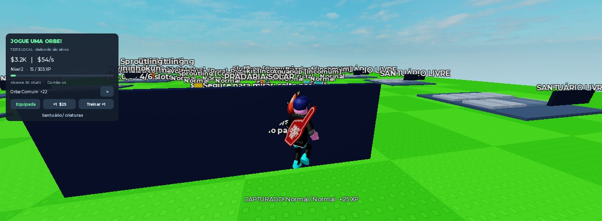

# Throw a Sphere! / Jogue uma Orbe!

Jogo Roblox de arremesso e captura de criaturas, com santuários que geram moedas, progressão e coleção. Este repositório reúne o código Luau, o ambiente Rojo e a pesquisa original com os prompts das próximas etapas.

## Checkpoint para continuar em outro PC

**18/11/2026, 16:20 — Brasília (UTC−3). Etapa atual: passo 1 concluído para protótipo local e validado no Roblox Studio via MCP. Toda a pasta de pesquisa está incluída neste repositório.**

**Publicação conferida:** o commit [`112c87f`](https://github.com/ViniciusNoetzold/throw-a-sphere-ROBLOX/commit/112c87f) publicou a pasta completa: 123 arquivos, incluindo as 44 imagens da pesquisa. O código, os prompts e as referências já estão disponíveis para clonar no outro PC.

| Etapa | Estado | Entrega |
| --- | --- | --- |
| Ambiente / GitHub | Configurado | Rojo 7.7.0, Luau 0.747, instalador local, build, testes e instruções para dois PCs |
| 1 — Base funcional | Protótipo local validado no Studio | Mira, captura, santuários, renda, XP, inventário e persistência implementada |
| 2 — Interface completa | Próxima etapa | HUD final, Big Numbers até Ocd, números flutuantes e loja Robux |
| 3 — Orbes e estruturas 3D | Planejada | Orbes 1/2/8 → pódio/fusão/portal → orbes 3–7 |
| 4 — Criaturas 3D | Planejada | Lotes A → B → C → D → E dos prompts originais |

**Próximo trabalho:** iniciar o passo 2 (HUD final, Big Numbers e loja Robux). Antes de publicar o jogo, validar também dois clientes, emulador móvel/controle e persistência em uma experiência separada de teste. Manter o protocolo de teste, README, commit e publicação a cada etapa.

## Rodar agora

Para apenas jogar o protótipo, clone ou baixe o repositório e abra **[game/ThrowASphere.rbxlx](game/ThrowASphere.rbxlx)** no Roblox Studio. Aperte **Play**. Esse arquivo pronto acompanha o Git e é regenerado pelo script de build.

Para desenvolver e validar o código:

No Windows x64, com Git, Python 3 e Roblox Studio instalados:

```powershell
git clone https://github.com/ViniciusNoetzold/throw-a-sphere-ROBLOX.git
cd throw-a-sphere-ROBLOX
powershell -ExecutionPolicy Bypass -File scripts/Install-Tools.ps1 -InstallStudioPlugin
powershell -ExecutionPolicy Bypass -File scripts/Test.ps1
```

Abra **`build/ThrowASphere.rbxlx`** no Roblox Studio e aperte **Play**. O mapa de teste é criado automaticamente. No mouse/toque, segure para mirar e solte sobre uma criatura. No controle, mire com a câmera e use R2. O painel permite comprar e equipar orbes, treinar e selecionar as criaturas que geram renda no santuário.

Para sincronizar mudanças ao vivo:

```powershell
powershell -ExecutionPolicy Bypass -File scripts/Serve.ps1
```

Conecte o plugin Rojo em `localhost:34872`. O guia completo está em [Ambiente e dois PCs](docs/AMBIENTE_E_DOIS_PCS.md).

## O que o passo 1 entrega

- Seis espécies iniciais com modelos provisórios: Pyrokit, Aquapup, Sproutling, Voltmouse, Fluffhop e Buzzleaf. O catálogo das 30 criaturas usa os valores dos prompts individuais.
- Mira parabólica, voo em curva, três balançadas independentes e crítico calculado no servidor. O servidor valida alvo, posição, distância, linha de visão, estoque e limites de frequência.
- Catch Lock de 4,5 segundos; uma captura bem-sucedida fica indisponível imediatamente para outros lançamentos.
- Falha concede 35% de XP, bônus de crítico e +5% de pity; captura registra tamanho e mutação sorteados no spawn. Combo chega a 10 e ativa os bônus Fever.
- Seis santuários pessoais, seis slots iniciais, slots adicionais nos níveis 5 e 15, renda por segundo e sinergias elementais. As primeiras capturas são equipadas automaticamente.
- Níveis 1–100, compra de orbes com moedas, troca da orbe equipada e treino com pequenas moedas para recuperar uma sessão sem estoque.
- DataStore com `UpdateAsync`, trava renovável por sessão, autosave, saída e encerramento; renda offline limitada a oito horas. Falhas ao carregar não substituem o save por valores iniciais.
- HUD funcional para testar o ciclo. A interface comercial completa pertence ao passo 2.

O passo 1 cobre o núcleo jogável pedido na sequência. Fusão, rebirth, recompensas diárias/playtime, missões, demais biomas, eventos, pódio global, Trading Plaza e monetização continuam no planejamento do prompt mestre; ainda não estão implementados. Não há IDs de produtos ou modelos 3D finais configurados.

## Persistência e publicação Roblox

**O Studio usa memória por padrão e reinicia os dados ao parar o Play.** O HUD sinaliza esse modo. O salvamento real é ativado automaticamente em servidores publicados. Para testar no Studio, consulte o guia antes de habilitar `StudioPersistence` e o acesso às APIs em uma experiência separada de teste. A configuração segue a [documentação oficial de DataStores](https://create.roblox.com/docs/cloud-services/data-stores).

Antes de publicar o jogo, configure o place para **6 jogadores** no Creator Hub. O GitHub guarda o projeto; publicar uma experiência no Roblox é uma operação separada e ainda não foi executada.

## Validação deste checkpoint

- Compilação sintática de todos os arquivos em `src/` com o compilador oficial Luau 0.747: passou.
- Fórmula de captura e limites de crítico/longa distância, XP e alcance: passou.
- Testes do servidor com mocks determinísticos de serviços Roblox: **51 cenários aprovados** (26 de captura, 6 de spawn/bloqueio e 19 de dados/santuário/progressão).
- Build Rojo do place `.rbxlx`: passou.
- Execução no Roblox Studio via MCP: **passou**. Servidor e cliente carregaram, com seis criaturas, santuário atribuído, HUD e estado inicial de $150/25 orbes.
- Captura pelo remote real e arremesso por input de mouse: **passaram**; mira crítica dourada, três balançadas, consumo de estoque, inventário, santuário e respawn observados.
- Economia e progressão reais no Studio: **passaram**; compra de uma orbe por $25, treino +1 força/+5 moedas, quatro capturas, nível 2 com 15 XP e renda de $54/s com sinergia de três criaturas de Planta.
- GitHub Actions: compilação, 51 cenários e build aprovados no [checkpoint da pasta completa](https://github.com/ViniciusNoetzold/throw-a-sphere-ROBLOX/actions/runs/44377462689).
- Persistência real entre servidores publicados: pendente de experiência de teste.

O Output não apresentou erro dos scripts do projeto. O Studio já emitia um aviso de asset incompatível `203785492` antes do Play, inclusive no place vazio; esse ID não aparece no código do jogo. Dispositivos reais, dois jogadores e disponibilidade do DataStore ainda precisam da validação indicada acima.



O [roteiro do Studio](docs/TESTE_NO_STUDIO.md) e o [guia de conexão MCP](docs/MCP_ROBLOX_STUDIO.md) permitem continuar os testes no outro PC.

## Organização

```text
src/shared/       Catálogos e regras compartilhadas
src/server/       Bootstrap e serviços autoritativos
src/client/       Mira, efeitos e HUD funcional
scripts/          Instalação, testes, build e servidor Rojo
tests/            Casos determinísticos sobre código de produção
docs/             Ambiente e continuidade entre computadores
game/             Place pronto para abrir no Studio
06_Projeto_.../   GDD, prompts base/UI, prompts 3D e protótipos originais
01_... a 05_.../  Pesquisa visual e referências originais
```

Os scripts originais em `scripts_prototipo_luau/` são referência. O código executável atual está em `src/`; não cole os protótipos antigos junto com ele, pois duplicariam os controladores e o servidor.

## Retomar / encerrar uma sessão

Ao iniciar em qualquer PC:

```powershell
git status
git pull --ff-only
```

Ao terminar uma etapa, execute os testes, atualize este checkpoint e publique:

```powershell
git add .
git commit -m "feat: descreva a etapa concluída"
git push origin main
git status --short --branch
```

O `git push` deste PC foi validado com a sessão já salva no **Git Credential Manager**. O repositório usa esse gerenciador na configuração local do Git; não é necessário refazer o login para publicar pelo Git. O token do comando `gh` continua inválido e só precisa ser renovado caso você queira usar a CLI `gh`. A configuração local não acompanha o clone: no outro PC, use a sessão do Git Credential Manager daquele computador e entre na sua conta quando solicitado. Nenhuma credencial foi adicionada ao repositório.
